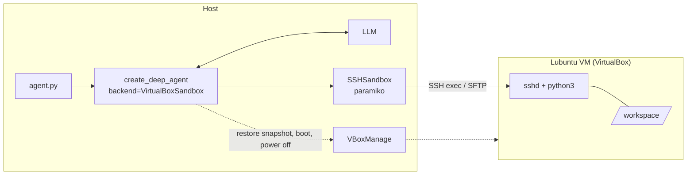

# Deep Agent VM Sandbox

**Run a [LangChain Deep Agent](https://docs.langchain.com/oss/python/deepagents/overview) inside a throwaway VirtualBox VM.**

The agent writes code, installs packages and runs shell commands, but all of it happens inside a Linux VM that is restored from a clean snapshot at the start of every run and powered off at the end. Your host machine is never touched.

```text
Agent writes files, runs commands  ->  inside the VM  ->  VM resets to a golden snapshot next run
```

## Why this exists

Agents that can execute shell commands are useful and risky. Hosted sandboxes (Daytona, E2B, Modal and others) solve this, but they cost money and need the internet. This project does the same job with something you already have: a local VM.

- **Free and local.** VirtualBox, a Linux VM and SSH. No accounts, no API keys for the sandbox.
- **A clean machine every run.** The VM is restored from a snapshot, so nothing the agent does survives.
- **A real Deep Agents backend.** It subclasses `BaseSandbox`, so the built-in `execute`, `read_file`, `write_file`, `edit_file`, `ls`, `glob` and `grep` tools all run inside the VM. There are no hand-written tool wrappers.

## How it works



`backend.py` contains two classes:

| Class | Job |
|---|---|
| `SSHSandbox` | The Deep Agents backend. A `BaseSandbox` subclass that implements `execute()`, `upload_files()`, `download_files()` and `id`. It works with any machine you can SSH into. |
| `VirtualBoxSandbox` | `SSHSandbox` plus VM lifecycle: restore the snapshot, boot headless, wait for SSH, and power off on `close()`. |

`BaseSandbox` builds `read`, `write`, `edit`, `ls`, `glob` and `grep` on top of those four methods by running small `python3` helpers over `execute()`. That is why the VM needs `python3`.

### Design notes

- **Real exit codes.** Commands run on their own SSH channel with stderr merged on the channel, not through a shell pipe, so the agent sees whether a command actually failed.
- **Timeouts.** Every command is wrapped in the VM's `timeout` command (default 300 s, configurable). Stdin is closed, so anything waiting for input fails instead of hanging.
- **Bounded output.** Output is capped at 1 MB per command and flagged as truncated. Deep Agents handles what the model actually sees.
- **Progress bars are collapsed** to their final state, while CRLF line endings in files are preserved.
- **Host-side audit log.** Every command is appended to `agent_audit.log` on the host, where the agent cannot edit it.
- **One SFTP session per transfer**, so parallel tool calls never share client state.
- **Secrets stay in the VM.** If `<workspace>/.env` exists, it is exported to every command.

## Requirements

**Host**
- Python 3.11+
- [VirtualBox](https://www.virtualbox.org/) with `VBoxManage` on your `PATH`
- `pip install deepagents paramiko`
- A LangChain chat model for the agent (see `models.py` below)

**Guest VM** (built and run with Lubuntu, but any Debian or Ubuntu-style Linux should work)
- `openssh-server`, `python3`, `bash` and GNU `timeout` (included in coreutils)
- A normal user account you can SSH into with a password or key

## Setup

### 1. Prepare the VM

Inside the VM:

```bash
sudo apt update
sudo apt install -y openssh-server python3 python3-pip git build-essential
```

Install now whatever the agent will need often. Everything installed before you take the snapshot is available instantly on every run.

On the host, with the VM powered off, forward a host port to the VM's SSH port:

```bash
VBoxManage modifyvm "<vm-name>" --natpf1 "ssh,tcp,127.0.0.1,2222,,22"
```

Also disable shared folders, Shared Clipboard and Drag'n'Drop for the VM in VirtualBox settings, so nothing bridges the host and the guest.

### 2. Take the golden snapshot

With the VM powered off and in the state you want every run to start from:

```bash
VBoxManage snapshot "<vm-name>" take "Agent-Golden-Image"
VBoxManage snapshot "<vm-name>" list   # confirm the name
```

### 3. Configure

Create a `.env` file (and load it however you normally do: `python-dotenv`, `uv run --env-file .env`, or exported variables):

```env
VM_NAME=LUBUNTU2          # name in VirtualBox
VM_USER=james             # user inside the VM
VM_PASSWORD=change-me     # or leave unset to use your SSH key
VM_HOST=127.0.0.1         # optional, default 127.0.0.1
VM_PORT=2222              # optional, default 2222
```

> The variable is called `VM_USER`, not `USERNAME`, because `USERNAME` is already set by Windows.

`agent.py` imports `model` from a `models.py` file in the same folder. It must export a LangChain chat model, for example:

```python
# models.py
from langchain.chat_models import init_chat_model

model = init_chat_model("<provider>:<model-name>")  # or any LangChain chat model you already use
```

### 4. Run

```bash
python agent.py
```

You will see the VM reset, boot, connect, run the task and power off:

```text
Resetting VM 'LUBUNTU2' to snapshot 'Agent-Golden-Image'...
Booting VM...
SSH connection established.
Sandbox ready: /home/james/workspace
Sending task to agent...
...
Powering off VM (changes are discarded on the next restore)...
```

## Usage

### Pass it to an agent

```python
from deepagents import create_deep_agent
from backend import VirtualBoxSandbox

backend = VirtualBoxSandbox(vm_name="LUBUNTU2", username="james", password="...")
try:
    agent = create_deep_agent(
        model=model,
        backend=backend,
        system_prompt=f"Your workspace is {backend.workspace_dir}. Use absolute paths with the file tools.",
    )
    agent.invoke({"messages": [{"role": "user", "content": "Write and run a script that prints the first 20 Fibonacci numbers"}]})
finally:
    backend.close()
```

### Use any SSH machine instead of VirtualBox

```python
from backend import SSHSandbox

with SSHSandbox(host="10.0.0.5", port=22, username="agent", key_path="~/.ssh/id_ed25519") as backend:
    ...
```

### Options

| Option | Default | Meaning |
|---|---|---|
| `snapshot` | `"Agent-Golden-Image"` | Snapshot restored before each run (`VirtualBoxSandbox`) |
| `workspace_dir` | `/home/<user>/workspace` | Where commands start; created if missing |
| `default_timeout` | `300` | Seconds before a command is killed |
| `connect_timeout` | `180` | Seconds to wait for SSH to come up after boot |
| `audit_log_path` | `"agent_audit.log"` | Host-side command log; `None` disables it |

### Paths

The Deep Agents protocol uses **absolute paths**. A relative path passed to `upload_files()` or `download_files()` returns `invalid_path`. Shell commands start in `workspace_dir`, so relative paths work there.

## Security model

The VM is the boundary. Read this before trusting it.

- **What it protects.** The agent's files, packages and processes live inside the VM. Restoring the snapshot discards all of it.
- **The workspace folder is not a security boundary.** The agent can run arbitrary commands in the VM, including `cd /`. `BaseSandbox` does not narrow what `execute()` can do either.
- **Secrets inside the VM are readable by the agent.** That includes the `.env` file. Only put credentials there that you are happy for the agent to use.
- **NAT gives the VM internet access.** The agent can download packages and also send data out. For stricter isolation, install what you need before snapshotting, then switch the VM to an isolated or host-only network.
- **Host key checking is off** (`AutoAddPolicy`) and password login is supported. That is fine for a local throwaway VM and not something to copy for remote machines. Use key auth and `known_hosts` there.

## Testing

LangChain ships a standard test suite for sandbox backends. Install `langchain-tests`, `pytest` and `pytest-asyncio`, then:

```python
# tests/test_standard.py
from collections.abc import Iterator
import pytest
from langchain_tests.integration_tests import SandboxIntegrationTests
from backend import SSHSandbox

class TestSSHSandbox(SandboxIntegrationTests):
    @pytest.fixture(scope="class")
    def sandbox(self) -> Iterator[SSHSandbox]:
        sb = SSHSandbox(host="127.0.0.1", port=2222, username="james", password="...", audit_log_path=None)
        try:
            yield sb
        finally:
            sb.close()
```

```bash
pytest tests/test_standard.py -o asyncio_mode=auto
```

Point it at a running VM, or any SSH server, since `SSHSandbox` does not manage the VM itself. In a trial run against a plain SSH server with deepagents 0.7.28, 79 of 86 tests passed. The failures were all in behavior inherited from `BaseSandbox`: glob results come back as absolute paths where the tests expect relative ones, and `write()` overwrites an existing file where one test expects an error. Results may differ with other versions.

## Troubleshooting

| Symptom | Likely cause and fix |
|---|---|
| `VBoxManage ... failed: Could not find a snapshot` | Wrong snapshot name. Run `VBoxManage snapshot "<vm>" list`. |
| `SSH ... did not come up within 180s` | sshd isn't running in the snapshot, or the port forward is missing. Check `--natpf1` and that `openssh-server` is enabled. |
| `SSH authentication failed` | Wrong `VM_USER` or `VM_PASSWORD`. Auth errors fail immediately and are not retried. |
| `VBoxManage: command not found` | Add the VirtualBox install folder to your `PATH`. |
| `externally-managed-environment` from pip | Ubuntu 23.04+ blocks system-wide pip. Use `pip install --break-system-packages` or a virtualenv in the VM. |
| Agent file writes fail with `invalid_path` | The path wasn't absolute. Tell the agent its `workspace_dir` in the system prompt. |
| Command output ends with `[Command timed out after Ns]` | Raise `default_timeout`, or pass a larger `timeout` for long installs. |

## Project structure

```text
.
├── agent.py       # builds the agent and runs one task
├── backend.py     # SSHSandbox (BaseSandbox) and VirtualBoxSandbox
├── models.py      # exports `model`, your LangChain chat model
├── .env           # VM_NAME, VM_USER, VM_PASSWORD, ...
└── agent_audit.log  # created at runtime: host-side command log
```

## Ideas for next steps

- Key-based auth and a pinned `known_hosts` entry for the VM
- Faster resets using VirtualBox's save-state instead of a full power cycle
- Cloning the golden VM to run several sandboxes in parallel
- A network lockdown mode for runs that need no internet

## Author

Built by [James Mwaura](https://github.com/JameZMw).

## License

MIT. Add a `LICENSE` file to the repository before publishing.